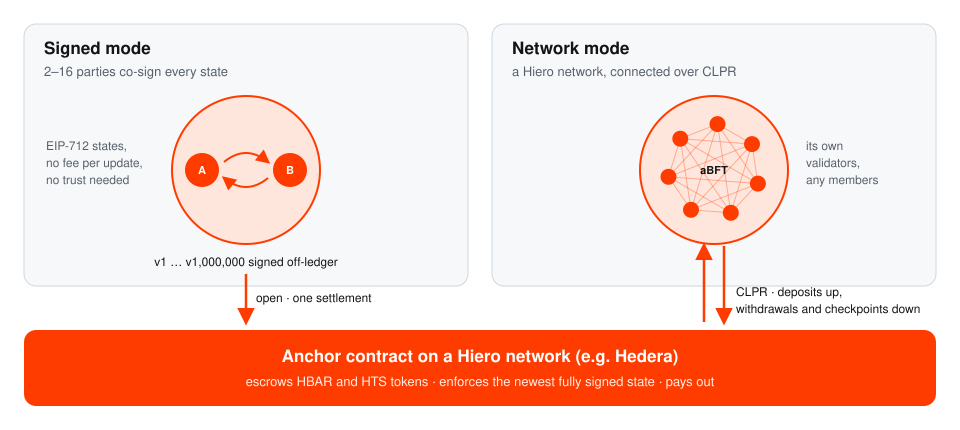

<p align="center">
  <a href="https://coldai.org">
    <picture>
      <source media="(prefers-color-scheme: dark)" srcset=".github/assets/coldai-logo-white.png">
      
    </picture>
  </a>
</p>

<p align="center">
  <picture>
    <source media="(prefers-color-scheme: dark)" srcset="brand/lightsphere-lockup-white.svg">
    
  </picture>
</p>

<h3 align="center">Off-ledger execution, settled on Hiero.</h3>

<p align="center">
  The reference implementation of the Lightsphere HIP. A small group runs its interaction off the ledger, as fast
  as its machines allow, and the ledger only locks the stakes at the start and pays out what everyone signed at
  the end. A whole Hiero network can do the same over CLPR.
</p>

<p align="center">
  <a href="https://github.com/ColdAI-org/lightsphere/actions/workflows/ci.yml"></a>
  <a href="https://github.com/ColdAI-org/lightsphere/actions/workflows/codeql.yml"></a>
  
  <a href="https://github.com/hiero-ledger/hiero-improvement-proposals/pull/1563"></a>
  <br>
  <a href="LICENSE"></a>
  
  
  
  
  
</p>

<p align="center">
  <a href="#quick-start">Quick start</a> ·
  <a href="docs/concepts.md">Concepts</a> ·
  <a href="docs/signed-mode.md">Signed mode</a> ·
  <a href="docs/network-mode.md">Network mode</a> ·
  <a href="docs/integration-guide.md">Integration guide</a> ·
  <a href="docs/benchmarking.md">Benchmarking</a> ·
  <a href="docs/security.md">Security</a>
</p>

> [!WARNING]
> **Pre-release.** These contracts have not been audited and have run only on local networks, against a mock of
> Hedera's token service. Do not use them with real value. See [docs/security.md](docs/security.md).

<p align="center">
  <picture>
    <source media="(prefers-color-scheme: dark)" srcset="docs/media/overview-dark.svg">
    
  </picture>
</p>

## Why

Games, agent-to-agent payments, streaming payments and order matching all produce thousands of state changes
between the same few parties, and almost none of those changes need the whole world to agree on their order.
Off-ledger channels that settle to a base ledger are the standard answer, and other ecosystems have shipped them:
Lightning on Bitcoin, state channels on Ethereum, and in 2026 Sui's programmable tunnels. Hiero had no standard.

Lightsphere is that standard, proposed to Hiero as
[HIP #1563](https://github.com/hiero-ledger/hiero-improvement-proposals/pull/1563). It is an Application HIP: no
consensus-node changes, so it can run on any Hiero network with smart contracts today.

## Two modes

|  | **Signed mode** | **Network mode** |
|---|---|---|
| The sphere is | 2–16 participants | A Hiero network, for example a private HashSphere |
| A state is agreed by | Every participant signing it (EIP-712) | The sphere network's consensus |
| You trust | Nobody. No state can move your funds unless you signed it | The sphere network's validators |
| The anchor sees | One open and one settlement | Deposits, withdrawals and checkpoints over CLPR |
| If something goes wrong | Newest fully signed state wins in a challenge window; watchtowers act for offline users | Halt after silence; everyone exits from the last checkpoint |

[Read the concepts →](docs/concepts.md)

## What is in this repository

| Path | What |
|---|---|
| [`contracts/`](contracts) | `LightsphereAnchor` (escrow, disputes, payouts, CLPR exits) and `LightsphereGateway` (the sphere-side CLPR application with an incremental Merkle tree). Foundry tests with a mock of HTS (`0x167`) and an order-preserving two-sided CLPR service that can fail or drop messages |
| [`harness/`](harness) | Go: the state encoding, `lsbench` (throughput by the HIP's accounting rule), `lsverify` (re-check a report) and `lsvectors` (cross-language test vectors) |
| [`ts/`](ts) | TypeScript client on viem: sphere IDs, EIP-712 signing and verification, and a watchtower |
| [`reports/`](reports) | Benchmark reports, verifiable with `lsverify` |
| [`docs/`](docs) | Concepts, both modes in depth, integration guide, benchmarking, security |
| [`brand/`](brand) | The Lightsphere mark, wordmark and lockups |

## Quick start

You need [Foundry](https://getfoundry.sh), Go 1.24+ and Node 23.6+.

```bash
git clone --recurse-submodules https://github.com/ColdAI-org/lightsphere && cd lightsphere
```

```bash
make check
```

That runs the Foundry suite, the Go tests and the TypeScript tests, including an end-to-end dispute on a local
anvil chain. To measure throughput on your machine:

```bash
make bench
```

### Settle a two-party sphere in TypeScript

```ts
import { signState, sphereId, anchorAbi, HBAR } from "./ts/src/index.ts";

const id = sphereId(296, anchor, params);           // what open(params) returns
// ... both parties fund, then exchange states off-ledger ...
const final = { sphereId: id, version: 1_000n, balances: [8n * 10n ** 8n, 12n * 10n ** 8n], appDataHash, isFinal: true };
const sigs = [await signState(alice, 296, anchor, final), await signState(bob, 296, anchor, final)];
await wallet.writeContract({ address: anchor, abi: anchorAbi, functionName: "closeCooperative", args: [final, sigs] });
```

The [integration guide](docs/integration-guide.md) covers funding, disputes, running a watchtower, the Go package,
and what is different on Hedera (tinybars versus weibars, HTS association, key types).

## What the tests prove

- **Network mode pays out exactly what came in.** `testFuzz_haltConservesFunds` runs random interleavings of
  deposits, transfers, withdrawals to any address, checkpoints, single-message relays, and failed deliveries and
  dropped Response callbacks in both directions. It then halts the sphere and has every account exit. Payouts must
  never exceed deposits, and unless a deposit's refund was lost they must equal deposits to the unit, with no exit
  reverting. It runs 10,000 times per CI run and has passed 20,000 locally.
  It found two flaws in the first draft of the HIP, both fixed in the spec and here
  ([details](docs/security.md#history)).
- **Three implementations, one encoding.** Go, Solidity and viem compute the same domain separator, sphere ID and
  digests from [`signed-v1.json`](contracts/test/vectors/signed-v1.json). Go's and viem's signatures are
  byte-identical, and the contract settles a sphere with them.
- **Disputes work end to end.** A participant starts a close with version 3; a watchtower replaces it with version
  250 inside the window; the payout follows version 250. In Solidity, and on anvil with the TypeScript watchtower.
- **Signatures can't be replayed or forged.** Tests cover other spheres, other anchors and other chain IDs,
  high-`s` signatures and out-of-range `v`, missing or wrong signers, join signatures for the wrong sphere, Hedera
  accounts that sign with a separate key, and states that create funds.
- **Independently reviewed.** An adversarial review before release found 14 issues, including three high-severity
  ones in how signatures were checked on Hedera. All are fixed, each with a regression test
  ([details](docs/security.md#history)).

## Measured

| | |
|---|---|
| Signed-mode throughput, one Apple M1 Max (10 cores), two-party | **46,688 effective tx/s** sustained over 65 s (peak 48,061) |
| Per core | about 4,700 effective tx/s |
| Machines for 40M effective tx/s at that rate | about 860 (spheres are independent, so it scales linearly) |
| `closeCooperative`, 16 participants | about 213,000 gas |
| A transfer on a sphere network (two leaf updates in a depth-32 tree) | about 130,000 gas |
| Contract sizes | anchor 20.3 KB, gateway 6.3 KB (EIP-170 limit 24 KB) |

An effective transaction is a new state version that every participant signed and every other participant
verified, as the HIP defines it. The report is in [`reports/`](reports) and verifies with `lsverify`. It is an
offline run: a public claim would also list the anchor-ledger transactions of every open and settlement.
[More on benchmarking →](docs/benchmarking.md)

## Status

| | |
|---|---|
| Specification | [HIP #1563](https://github.com/hiero-ledger/hiero-improvement-proposals/pull/1563), Draft, Application category. Discussion: [#1562](https://github.com/hiero-ledger/hiero-improvement-proposals/discussions/1562) |
| Contracts | Feature-complete for both modes. Not audited |
| Hedera | Tested against a mock of the HTS system contract (`0x167`). Hedera testnet deployment is next |
| CLPR | Tested against a mock that follows the CLPR spec's ordering rules. Not yet run against the LFDT-CLPR reference service |

### Roadmap

1. Deploy on Hedera testnet and run a signed-mode sphere end to end with real HTS tokens, including an ED25519 account signing with a separate key, and confirm the custom-fee checks against real HTS.
2. Run network mode between two Hiero networks over the LFDT-CLPR reference CLPR Service.
3. A faster signing path for the benchmark, and a public throughput run with every sphere opened and settled on Hedera.
4. External audit.
5. From the HIP's open issues: adding and removing funds while a sphere is open, on-chain adjudicators, a timeout-based reclaim for deposits whose refund was lost, NFTs, and cross-ledger anchors.

## Contributing

Contributions are welcome. Read [CONTRIBUTING.md](CONTRIBUTING.md) (DCO sign-off, Conventional Commits,
`make check`). Report security issues privately as described in [SECURITY.md](SECURITY.md). Changes that affect
the wire format or the trust model should also be raised on the HIP, so that every implementation stays
compatible.

## Licence

[Apache License 2.0](LICENSE). The Lightsphere name and mark are described in [brand/](brand).

<p align="center"><sub>Built by <a href="https://coldai.org">ColdAI</a>, a frontier R&amp;D lab building agentic AI and distributed-ledger systems.</sub></p>
