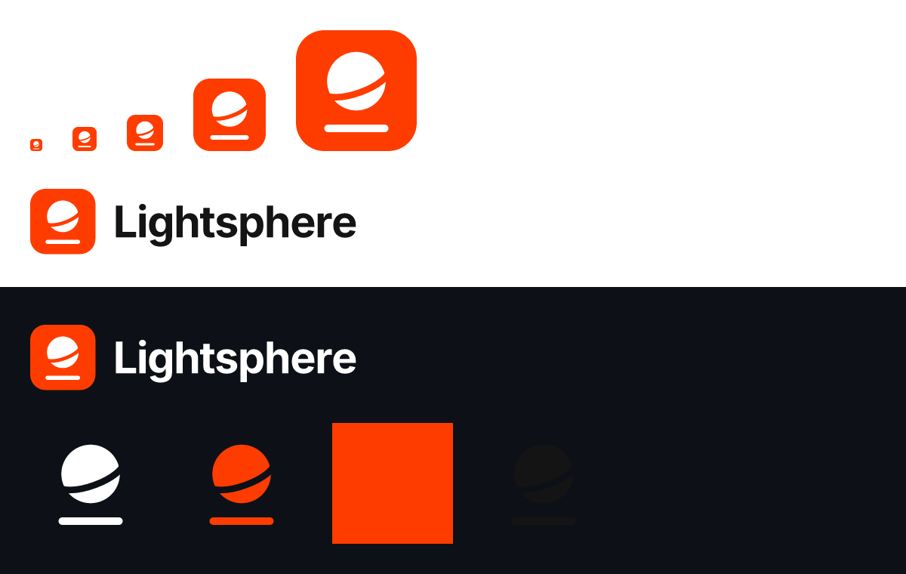

# Lightsphere brand

  
  &nbsp;
  

**The mark.** A solid sphere cut by a tilted equator, floating above a line. The sphere is the off-ledger
execution: fast, self-contained and private to its participants. The line is the ledger it settles to. The gap
between them is the point of the design: activity happens above the ledger, and only the result comes down.

## Files

| File | Use |
|---|---|
| `lightsphere-mark.svg` | App icon and avatar: white glyph on a ColdAI-orange rounded square. Legible from 32 px |
| `lightsphere-glyph-{orange,white,ink}.svg` | The glyph alone, on a plain background. The equator cut is a mask, so it works on any colour |
| `lightsphere-wordmark-{ink,white}.svg` | "Lightsphere" in Inter Bold, −2.5% tracking, outlined (no font needed) |
| `lightsphere-lockup-{ink,white}.svg` | Mark + wordmark. Use `ink` on light backgrounds and `white` on dark |
| `preview.png` | Review sheet (light and dark), not for use |
| `../.github/assets/social-preview.png` | GitHub social preview, 1280×640 |

Everything here is generated by [`tools/brand/render.mjs`](../tools/brand/render.mjs) (`npm install && npm run render`
in `tools/brand`). Edit the script, not the files.

## Colour

| Token | Hex | Use |
|---|---|---|
| ColdAI orange | `#FF3C00` | The mark, accents, large text |
| Ink | `#141414` | Wordmark and text on light backgrounds |
| White | `#FFFFFF` | Glyph on orange, text on dark backgrounds |

## Don'ts

Don't recolour the orange square, add effects or outlines, rotate the glyph, or set "Lightsphere" in another
typeface next to the mark.
