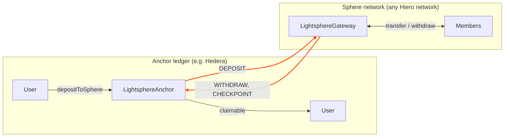

# Network mode

In network mode the sphere is not a handful of co-signers but a whole Hiero network, for example a private,
permissioned deployment such as a HashSphere. Members transact there at that network's speed, with its own
consensus. Assets move between the anchor ledger and the sphere network as [CLPR](https://github.com/LFDT-CLPR)
messages. The sphere reports its balances to the anchor at a fixed interval, and if it ever goes silent, every
member can exit from the last report.



The anchor and the gateway are the two CLPR applications on one CLPR Channel. CLPR proves every message with a
state proof from the sending network, so neither side relies on a relayer's word.

## Configuration

```solidity
struct NetworkConfig {
    string  sphereLedgerId;     // CAIP-2 id of the sphere network, as configured in CLPR
    bytes32 channelId;          // the CLPR Channel between the anchor ledger and the sphere network
    bytes32 connectorId;        // the CLPR Connector that pays for the anchor's outbound messages
    address gateway;            // the gateway contract on the sphere network
    uint64  checkpointInterval; // seconds between checkpoints
    uint64  haltTimeout;        // seconds of silence before anyone may declare a halt (>= 3 x interval)
}
```

`open` takes this ABI-encoded in `networkConfig`, so the `sphereId` commits to the gateway, the Channel and the
timing. Anyone can call `open`, including with a malicious gateway, so **wallets must show users the configuration
a sphere ID commits to** before they deposit, and should keep an allow-list of known sphere networks.

## Messages

Every payload is `abi.encode(uint8 msgType, bytes32 sphereId, bytes body)`.

| Type | Name | Direction | Body |
|---|---|---|---|
| 1 | DEPOSIT | anchor → sphere | `(uint64 depositId, address asset, uint256 amount, address recipient)` |
| 2 | WITHDRAW | sphere → anchor | `(uint64 withdrawalId, uint64 sphereEpoch, address account, address asset, uint256 amount, address recipient)` |
| 3 | CHECKPOINT | sphere → anchor | `(uint64 sphereEpoch, bytes32 balancesRoot, uint64 lastAppliedDepositId)` |

### Deposits

A user calls `depositToSphere(sphereId, asset, amount, recipient)` on the anchor. The anchor escrows the asset,
gives the deposit the next `depositId`, and sends a DEPOSIT. The gateway credits `recipient` on the sphere
network. CLPR then returns a Response:

- **Success:** nothing to do.
- **Failure** (the gateway rejected it, or CLPR could not deliver it): the anchor credits the depositor's
  `claimable` balance and marks the deposit refunded.

CLPR delivers Responses best-effort: it drops a callback that reverts, and in some cases a callback may not run
at all. The anchor's `onClprResponse` never reverts, and **nothing in the exit rules depends on a success
Response arriving.**

### Withdrawals, and why they wait

An account burns its sphere balance through the gateway, which sends a WITHDRAW naming the account, the
anchor-ledger recipient and the current epoch. The anchor records it as **pending**. It becomes payable only
once a checkpoint for that epoch (or a later one) has arrived; then anyone calls `releaseWithdrawal`.

This wait is what makes the halt exit safe. Without it, the anchor could pay the same funds twice:

1. A checkpoint records Alice with a balance of 100.
2. Alice transfers 100 to Bob on the sphere.
3. Bob withdraws 100, and the anchor pays him at once.
4. The sphere halts before the next checkpoint.
5. Alice exits with her checkpointed balance of 100.

The anchor has paid 200 for 100 deposited. Holding Bob's withdrawal until a checkpoint covers it means that,
after a halt, either the checkpoint includes the transfer (and Alice's exit is 0) or Bob's withdrawal is never
released. The cost is that a withdrawal takes up to one `checkpointInterval` longer.

The withdrawal is counted against the **account that burned it**, not the recipient: the account's leaf in the
next checkpoint records the burn, and the exit formula has to subtract it from the same account.

### Checkpoints

At least every `checkpointInterval`, anyone may call `checkpoint()` on the gateway. It sends the current epoch,
the root of the balance tree, and `lastAppliedDepositId`, then starts the next epoch. Each leaf is:

```
leaf = keccak256(bytes.concat(keccak256(abi.encode(
    address account,
    address asset,
    uint256 balance,                        // at the end of the epoch
    uint256 cumulativeDepositsApplied,      // all deposits ever credited to the account
    uint256 cumulativeWithdrawalsInitiated  // all withdrawals ever burned by the account
))));
```

The leaf is hashed twice so that an internal tree node (64 bytes) can never be passed off as a leaf. The tree is
hashed with sorted pairs, so standard OpenZeppelin `MerkleProof` verifies it.

**The reference gateway keeps the tree up to date as balances change.**

- It is a depth-32 positional tree stored in the contract, with room for about 4.3 billion leaves, so it cannot
  realistically be filled.
- Every balance change updates one path of 32 hashes, so sending a checkpoint costs the same however many accounts
  exist. A transfer that touches two leaves costs about 130,000 gas.
- Zero-amount transfers and transfers or withdrawals to `address(0)` are rejected, so nobody can create leaves for
  free or strand funds.
- Every leaf change emits `LeafUpdated`, so anyone can rebuild the tree, and every member's proof, for any
  checkpoint.

## Halt and exit

If the anchor hears nothing from the sphere for `haltTimeout`, anyone can call `declareHalt`. From then on the
anchor rejects every WITHDRAW and CHECKPOINT (even ones that were proven earlier and arrive late), every new
deposit and every release, and ignores late deposit Responses. Each member then exits, once per asset.

**With a proof**, for an account that has a leaf in the last accepted checkpoint:

```
exit = balance
     + (netDeposited − cumulativeDepositsApplied)       // deposits the sphere had not applied yet
     + (cumulativeWithdrawalsInitiated − withdrawn)     // withdrawals burned but never released
```

`netDeposited` and `withdrawn` are the anchor's own records for that account. With an honest sphere both
adjustments are zero or positive.

**Without a proof**, for an account with no leaf: `exit = netDeposited − withdrawn`.

- **When it's allowed:** only if no checkpoint was ever accepted, or if none of the account's *live* deposits
  (sent and not refunded) has an ID at or below the checkpoint's `lastAppliedDepositId`. Under that condition
  none of them can have been applied by the checkpoint.
- **Why it can't overpay:** the amount can then only be lower than what a proof would give, so skipping the
  proof can never pay too much.
- **What it relies on:** only on deposits the anchor sent and refunds it received, never on a success Response
  arriving. An earlier version relied on success Responses, and an external review showed how a dropped callback
  could then overpay; see [security](security.md#history).

### A worked example

Alice deposits 100. A checkpoint records her balance as 100. Then, in the next epoch, she withdraws 30, sends 20
to Bob, and Bob withdraws those 20. The sphere halts **before** the next checkpoint arrives.

| | Alice | Bob |
|---|---|---|
| Leaf in last checkpoint | balance 100, deposits applied 100, withdrawals 0 | none |
| Anchor records | netDeposited 100, withdrawn 0 (her 30 is pending, never released) | netDeposited 0, withdrawn 0 |
| Exit | 100 + (100 − 100) + (0 − 0) = **100** | without proof: 0 − 0 = **0** |

Everything after the last checkpoint is rolled back, and the anchor pays out exactly the 100 it holds.

If the second checkpoint **had** arrived (Alice 50, Bob 0, with the withdrawals recorded) and both withdrawals had
been released before the halt, Alice would already have 30 claimable and exit with 50 + 0 + (30 − 30) = 50, and
Bob would have 20 claimable and exit with 0. Total paid: 30 + 50 + 20 = 100.

### How this is tested

`testFuzz_haltConservesFunds` runs random sequences of 48 operations, then halts the sphere and has every account
exit by the best route available. The operations are:

- deposits, and failed deliveries in both directions,
- dropped Response callbacks in both directions,
- transfers, withdrawals to any address, and checkpoints,
- single-message relays in either direction, so messages arrive in every possible interleaving,
- releases.

It asserts that **total paid out never exceeds total deposited**. Unless a deposit's *failure* Response was lost, it
also asserts that the two are exactly equal, to the unit, and that no exit reverts. It runs 10,000 times in CI and has
passed 20,000 runs locally. The mock CLPR service keeps one ordered queue per direction holding both messages and
Responses, as the CLPR specification requires.

**Known limitation: a lost refund.** If the failure Response for a deposit is lost, the anchor never learns that
the deposit failed. While the sphere runs, the depositor's funds stay in escrow, unrefunded. After a halt, they
return through the recipient's exit if the recipient has a leaf. Otherwise they stay in escrow: never paid twice,
but not recoverable by the depositor. A timeout-based reclaim is an open issue in the HIP.

This fuzz test found both of the bugs described above in the first draft of the HIP. See [security](security.md).

## Data availability

To exit with a proof, a member needs their leaf and Merkle proof for the last accepted checkpoint, and a dead
sphere network cannot provide them. Protect against this:

- **Wallets** should fetch and keep their proof after every checkpoint (`proofOf(account, asset)` on the gateway
  returns it against the current root; call it right after `checkpoint()`, or rebuild it from `LeafUpdated`
  events).
- **Sphere operators** should publish every checkpoint's full tree somewhere that does not depend on the sphere
  network.
- A member who has lost their proof can still use the proof-free exit where the rule allows it.

## Trust

Network mode is only as honest as the sphere network. A colluding supermajority of its validators, or a
compromised CLPR verifier for the Channel, could forge withdrawals or checkpoints. The halt exit protects members
if the sphere **stops**; it does not protect them if the sphere **lies**. Two limits contain the damage:

- **A per-sphere escrow cap.** The anchor never pays out more for a sphere than was deposited into it. A dishonest
  sphere can lose its own escrow and nothing else on the anchor.
- **Configuration is public.** The sphere ID commits to the gateway and Channel, so members can see exactly whose
  validators they are trusting.

CLPR payloads are not encrypted: deposits, withdrawals and each checkpoint's balances are visible on both ledgers.
A private sphere settling to a public anchor should settle through a few omnibus accounts if member balances
must stay private.
