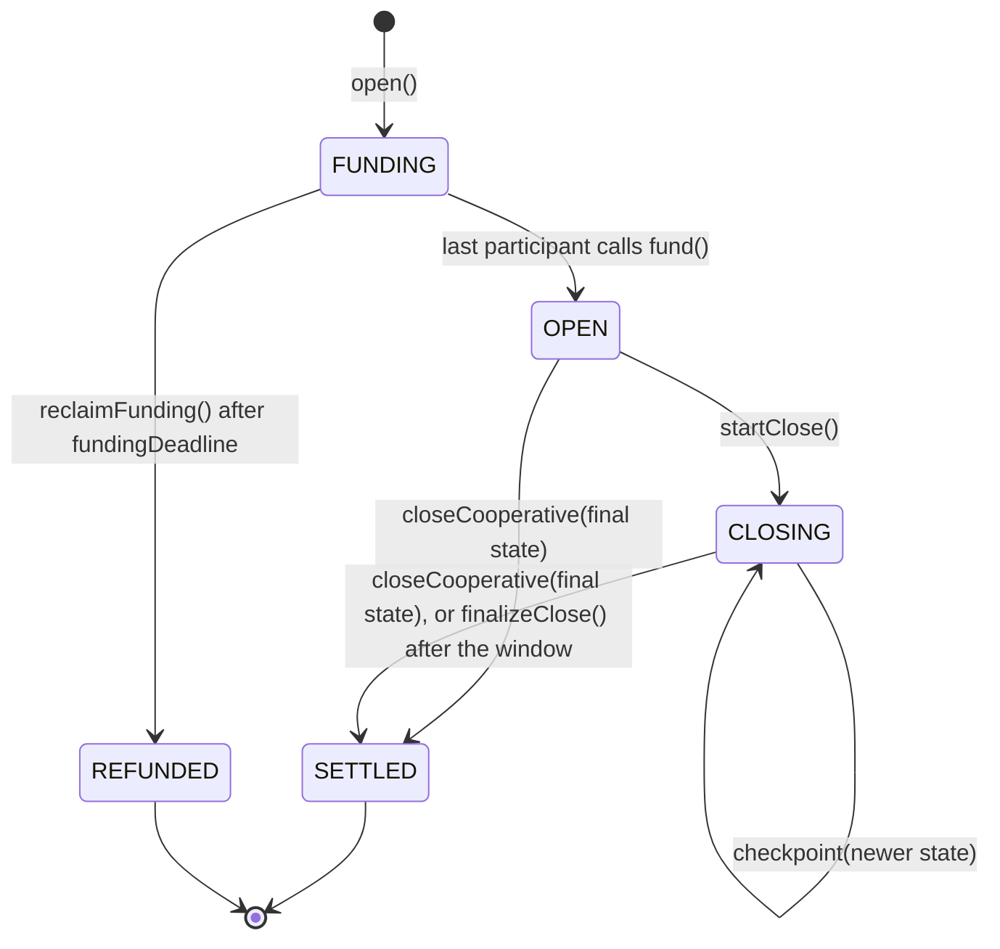
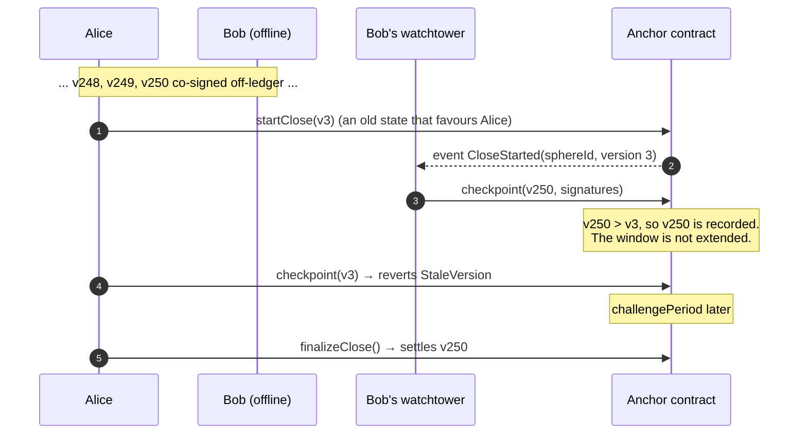

# Signed mode

In signed mode, 2 to 16 participants lock assets in the anchor contract, exchange co-signed states off-ledger, and
settle the last one. No participant needs to trust any other: the anchor never pays out according to a state that
someone did not sign.

## Lifecycle



1. **Open.** Anyone calls `open(params)` with:
   - the participants (the accounts that fund and get paid) and one **signing address** for each,
   - the assets: `address(0)` for HBAR, or an HTS fungible token or ERC-20 address,
   - each participant's initial deposit,
   - the challenge period (between the deployment's minimum and 30 days),
   - a funding deadline.

   The sphere ID commits to all of these, plus the chain ID and the anchor address:
   `sphereId = keccak256(abi.encode(chainId, anchor, params))`.
2. **Fund.** Each participant calls `fund(sphereId, joinSig)`:
   - It pays its row of `initialDeposits`: HBAR as `msg.value`, tokens by `transferFrom` against an allowance.
   - `joinSig` is the participant's signing key signing `JoinSphere(sphereId, participant)`. This proves the key
     works before anyone's money depends on it.
   - Every participant must fund, even one with a zero deposit.
   - When the last participant has funded, the sphere is `OPEN`. If the deadline passes first, anyone can call
     `reclaimFunding` and every deposit is returned.
3. **Run.** The participants exchange states off-ledger. Each new state has a higher `version`, and each
   participant signs it after checking it. All the activity happens here; the anchor sees none of it.
4. **Close cooperatively.** When everyone agrees, they sign a state with `isFinal = true`, and anyone submits it
   with `closeCooperative`. Settlement is immediate. This also works while a unilateral close is under way, as
   long as the final state is not older than the one recorded.
5. **Or close unilaterally.**
   - Any participant can call `startClose`, optionally passing the newest state it holds. That state is recorded
     if it is newer than the recorded one, and ignored otherwise.
   - A challenge window of `challengePeriod` seconds opens. Anyone holding a newer fully signed state can submit
     it with `checkpoint`.
   - When the window ends, anyone calls `finalizeClose`. The newest recorded state is settled, or the initial
     deposits if no state was ever recorded.
6. **Withdraw.** Settlement credits each participant's `claimable` balance. Each participant calls
   `withdraw(asset)` to collect, or `withdrawTo(asset, to)` to have it paid elsewhere (for example from a
   contract that cannot receive HBAR).

## The state

```solidity
struct SphereState {
    bytes32   sphereId;
    uint64    version;     // strictly increasing
    uint256[] balances;    // participant-major: index = participant * assets.length + asset
    bytes32   appDataHash; // commitment to the application's own state; stored, never interpreted
    bool      isFinal;     // everyone agrees this ends the sphere
}
```

The anchor rejects any state whose balances do not add up, for each asset, to the total deposited. A state can
redistribute funds but never create them.

### Signing (EIP-712)

States are signed as EIP-712 typed data, so ordinary wallets and hardware signers can show them to the user:

```
EIP712Domain(string name,string version,uint256 chainId,address verifyingContract)
  name = "Lightsphere", version = "1"
  chainId = the anchor ledger's EVM chain ID (Hedera: mainnet 295, testnet 296, previewnet 297)
  verifyingContract = the anchor contract

SphereState(bytes32 sphereId,uint64 version,uint256[] balances,bytes32 appDataHash,bool isFinal)
JoinSphere(bytes32 sphereId,address participant)
```

Because the domain names the chain and the contract, and the state names the sphere, a signature is only ever
valid for one sphere on one anchor on one network. The test suites check this in all three languages.

### Signing keys, and why they are separate from accounts

Every participant names a **signing address**: an ordinary secp256k1 key. The anchor checks state signatures with
`ecrecover` against that address and nothing else. A signature is accepted only if it:

- is 65 bytes (`r || s || v`),
- has `v` in {0, 1, 27, 28},
- has a low `s`, so it cannot be rewritten into a second valid form,
- recovers to the participant's signing address.

For an ordinary ECDSA account the signing address is simply the account's own EVM address. A Hedera account with
an ED25519 key, a threshold key or a key list names any secp256k1 key it controls instead, for example a session
key held by its wallet. Payouts always go to the participant's account, never to the signing key.

An earlier draft verified signatures against the participant's Hedera account through HIP-632's
`isAuthorizedRaw`. A review against the Hedera services source showed three problems with that:

1. **Key rotation.** `isAuthorizedRaw` checks an ED25519 account's *current* key. A participant could rotate
   their key after signing, and every state they had signed would stop verifying.
2. **Cost.** Each ED25519 check costs about 1.5 million gas, so a sphere with about ten ED25519 participants could
   never record a state within Hedera's 15 million gas limit per transaction.
3. **Long-zero ECDSA accounts.** `isAuthorizedRaw` rejects ECDSA signatures for accounts named by their long-zero
   address, so those participants could never produce a signature the anchor accepts.

Binding a plain signing key into the sphere ID avoids all three. Signatures stay valid whatever happens to the
account afterwards, every check costs the same small amount, and the join signature at funding catches a
participant whose key cannot sign before anyone's money depends on it.

## Disputes

The rule is simple: **the highest version that everyone signed wins**, provided it reaches the anchor before the
challenge window ends.



Design choices behind the rule:

- **The window is not extended** by later submissions, so a griefer cannot keep funds locked with a stream of
  slightly newer states.
- **The window is bounded** to 30 days, so nobody can open a sphere whose unilateral close never ends.
- **Anyone can submit a newer state,** not only participants. A watchtower can act for an offline participant with
  no special permission. Only a participant can *start* a close.
- **Payouts are pulled, not pushed.** An HTS transfer to one account can fail (no token association, frozen, no
  KYC). With pull payments, one blocked recipient never blocks the others.

### Choosing a challenge period

A participant who is offline for the whole window, with no watchtower, can lose to a stale state. Pick a
`challengePeriod` that covers your worst expected downtime. The deployment sets a minimum
(`MIN_CHALLENGE_PERIOD`); the HIP recommends at least one hour on public networks. Hiero finality takes seconds,
so even short windows are safe *as long as someone is watching*.

### Watchtowers

The [TypeScript client](integration-guide.md#run-a-watchtower) includes a reference watchtower.

- The participant's wallet hands it every new fully signed state with `guard()`. The watchtower checks every
  signature against the signing addresses recorded on the anchor before it keeps anything, so a forged
  high-version state cannot displace a real one.
- It listens for `CloseStarted` and submits its state if the anchor's recorded version is older.
- It persists what it guards, can replay events from a block after a restart, and sweeps every guarded sphere on
  a timer, so a close that started while it was offline is still caught inside the window.
- End-to-end tests on a local chain run the dispute above, the forged-state case and the restart case.

## Gas

Measured on a local EVM (Cancun) by the Foundry suite:

| Operation | Gas |
|---|---|
| `closeCooperative`, 16 participants (16 signature checks) | about 213,000 |

Signature checks use only `ecrecover`, so the cost is the same for every kind of Hedera account. On Hedera, gas is
priced in HBAR at the network's published rate.

## Limits in v1

- Funding is fixed when the sphere opens. To add or remove funds, close and reopen. Changing funds while a
  sphere is open is an open issue in the HIP.
- Application rules are not judged on-ledger: `appDataHash` is stored, not interpreted.
- HTS NFTs are not supported as sphere assets.
- **Custom fees.**
  - HTS tokens with custom fees are rejected at `open`.
  - The anchor checks again before every token payout, because a token's fee schedule can change later. A fee
    charged to the anchor would come out of every sphere's escrow, so payouts in that token pause until the fee
    is removed. HBAR and other tokens are unaffected.
  - ERC-20s that take a fee on transfer are rejected by balance checks at funding and at payout.
